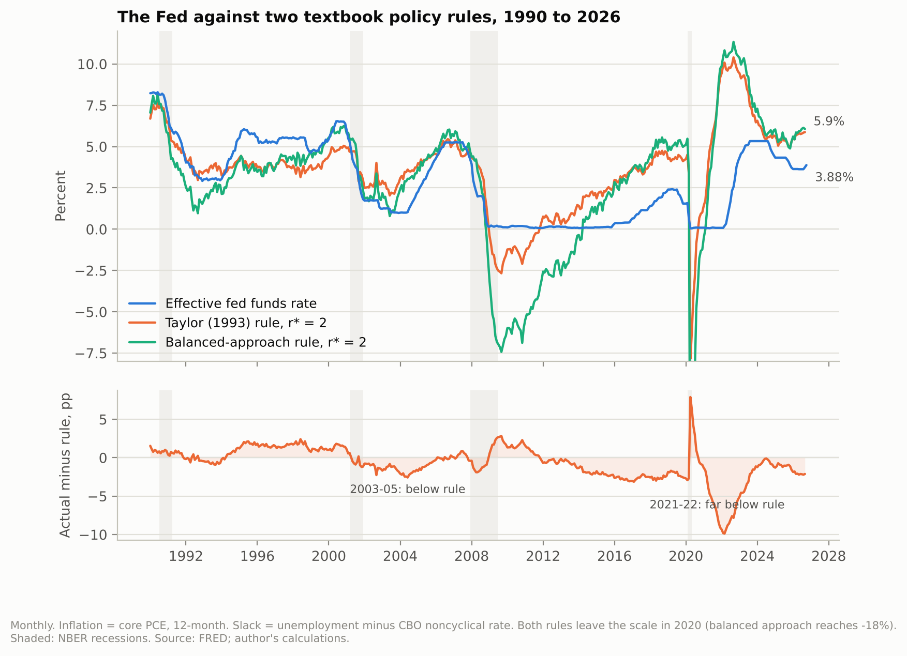
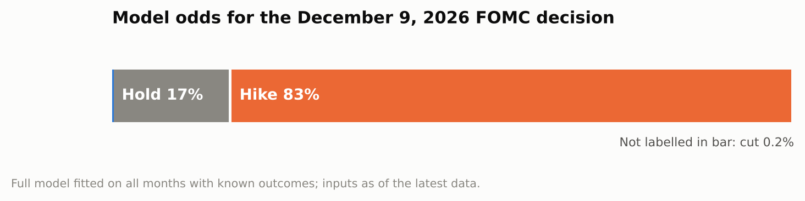
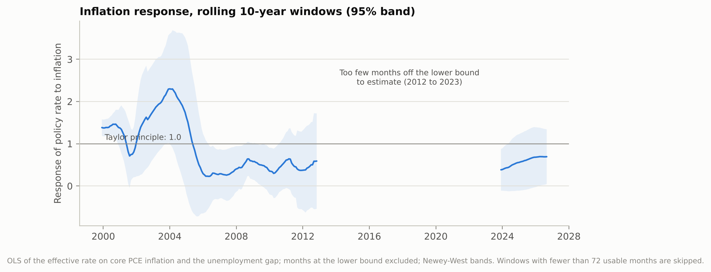
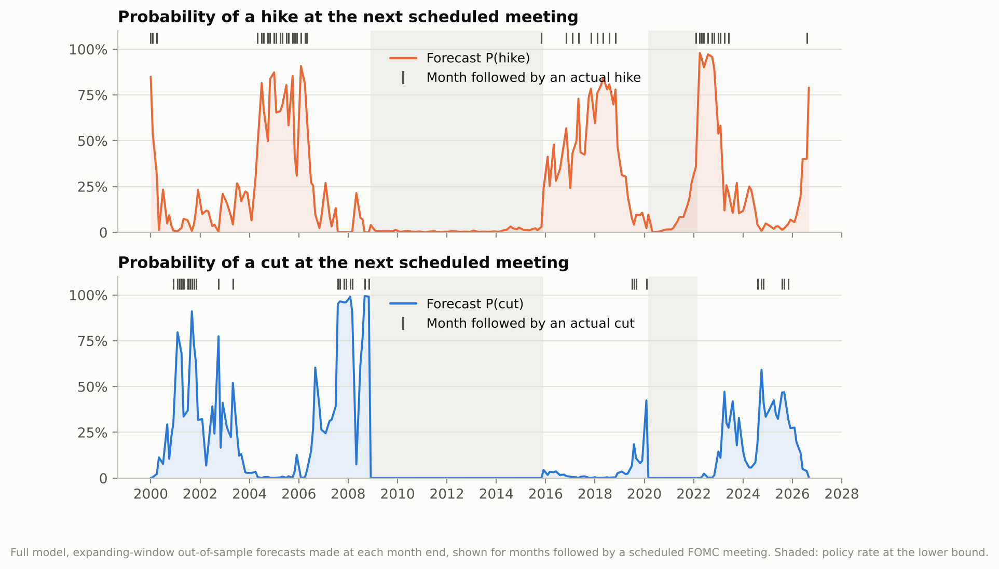
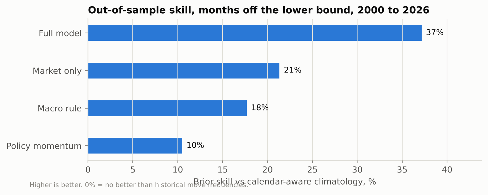
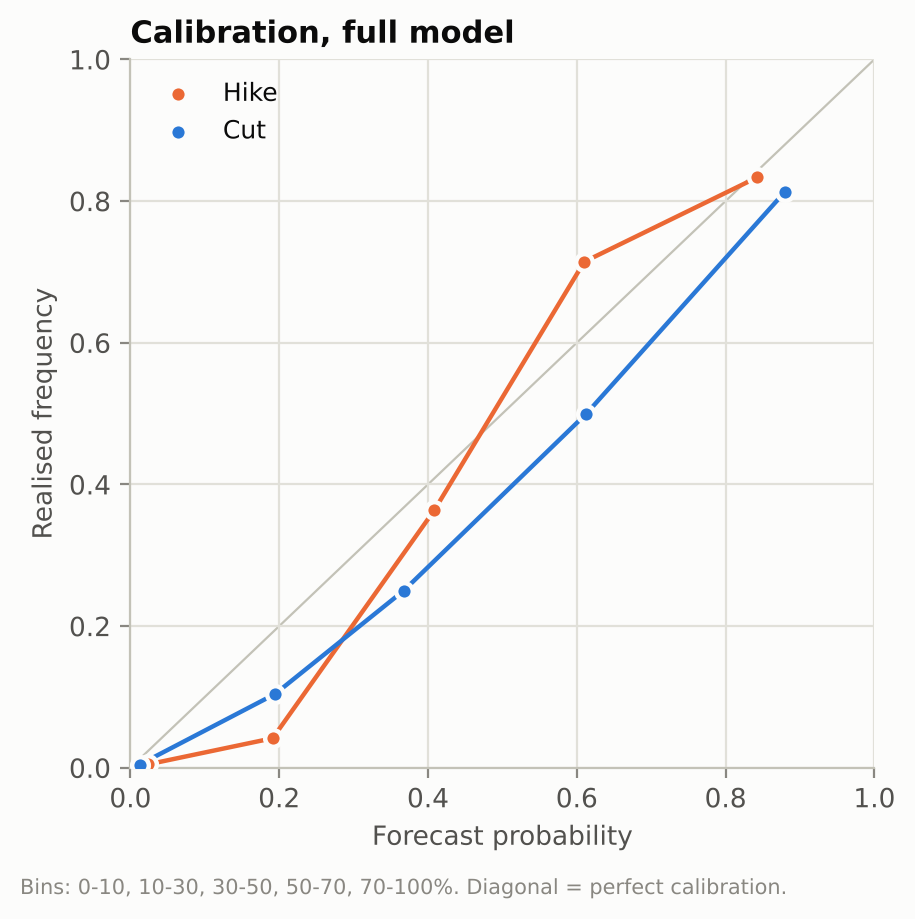

# What will the Fed do next? An FOMC reaction function and rate-decision model

**Jay Leggette** · Stanford University (Economics, Urban Studies) · data through 23 November 2026

This project asks two questions about the Federal Open Market Committee:

1. **How does the Fed set rates?** I estimate its reaction function (how strongly the policy rate responds to inflation and labor-market slack) and compare actual policy with the rules the Fed itself publishes.
2. **Can that be turned into a forecast?** I build a model that, at the end of each month, gives the probability of a hike, a hold or a cut by the end of the next month. I test it out of sample from 2000 to 2026, using only information that existed at the time.

Everything here reproduces from public data with one command, and the tests check the absence of look-ahead bias directly.

---

## Headline results

| | |
|---|---|
| **Reaction function, 1990 to 2008** | The policy rate rises **1.32** points for each point of inflation (s.e. 0.46). That point estimate is above 1, as the Taylor principle requires, though the interval is wide. The implied neutral real rate is **2.0%**. |
| **Reaction function, 1990 to 2026, zero-bound quarters treated as censored** | Inflation response **1.84**, slack response **-4.09**, implied neutral rate **0.3%**. Dropping zero-bound quarters instead of modelling them gives smaller estimates of both responses. |
| **Out-of-sample skill, 2000 to 2026** | The full model improves the Brier score by **40%** over calendar-aware historical frequencies (37% in months away from the zero bound). It calls **48 of 71** moves. |
| **Does the model beat the market?** | A model using Treasury yields alone gets 26% (21% off the zero bound). Adding macro data and the policy state lifts that to 40%, and the gain is statistically significant (Diebold-Mariano **p = 0.04**, or **p = 0.025** off the zero bound). |
| **Does statement tone help?** | No. A hawkish/dovish score of each FOMC statement adds nothing out of sample (p = 0.89). Markets appear to absorb the statement on the day it is released. |
| **Next meeting (9 December 2026)** | **Hike 83%**, hold 17%, cut under 1%. |
| **Where the rules put policy today** | With core PCE inflation at 3.1% and unemployment 0.2 points below the CBO's noncyclical rate, Taylor (1993) prescribes **5.9%** (r* = 2) or **4.4%** (r* = 0.5). The target range midpoint is **3.875%**. |





---

## 1. Data

All series are public. The raw files are in `data/raw/` exactly as downloaded.

| Source | Series | Use |
|---|---|---|
| FRED (St. Louis Fed) | `FEDFUNDS`, `CPIAUCSL`, `CPILFESL`, `PCEPILFE`, `UNRATE`, `PAYEMS`, `TB3MS`, `GS2/5/10/30` (monthly); `NROU` (quarterly, CBO) | Inflation, slack, payrolls, rates |
| FRED, daily | `DFEDTAR` (target, to 2008), `DFEDTARU/L` (range, from Dec 2008), `DFF`, `DGS3MO` to `DGS10` | Exact policy target and end-of-month yields |
| Federal Reserve Board | FOMC historical materials by year | Scheduled meeting dates, 1990 to 1999 |
| [FOMC communications archive](https://github.com/vtasca/fed-statement-scraping) (scraped from federalreserve.gov) | Statements and minutes since 2000 | Meeting dates since 2000, statement text |

**Timing.** A row dated month *t* describes the world at the end of month *t*. Market data and the policy target are known in real time. Inflation, unemployment and payrolls for month *t* come out during month *t+1*, so every macro feature is lagged one month.

**Effective dates.** Since March 2017 a rate change takes effect the day after the decision (the September 16, 2026 hike shows up on September 17). The meeting calendar is aligned to effective dates. A test checks every move since 1994 against this convention.

**The 2025 shutdown.** The BLS never published October 2025 CPI or the October 2025 unemployment rate. Those single months are interpolated so that year-over-year rates exist for October 2026.

---

## 2. Policy rules

I use the rules in the form the Board uses in its *Monetary Policy Report*, with the unemployment gap standing in for the output gap:

```
Taylor (1993):        R = r* + π + 0.5(π − 2) + 1.0(u* − u)
Balanced approach:    R = r* + π + 0.5(π − 2) + 2.0(u* − u)
```

π is 12-month core PCE inflation, u is the unemployment rate, and u* is the CBO's noncyclical rate.

The bottom panel of the figure above shows the familiar episodes. Policy ran below the rule in 2003 to 2005 and far below it in 2021 to 2022, when inflation took off while the rate sat at zero. From 2009 into the early 2010s, and again in 2020, the rules called for negative rates, which the zero bound ruled out.

**Prescriptions today** (core PCE for September 2026 = 3.12%, u = 4.2%, u* = 4.39%; target midpoint 3.875%):

| Rule | r* | Prescribed rate | vs. today |
|---|---|---|---|
| Taylor (1993) | 2.0 | 5.87% | +2.00 pp |
| Taylor (1993) | 0.5 | 4.37% | +0.50 pp |
| Balanced approach | 2.0 | 6.06% | +2.19 pp |
| Estimated rule, long-run target | 0.32 | 5.17% | +1.30 pp |
| Estimated rule, one quarter of gradual adjustment | 0.32 | 3.96% | +0.09 pp |

Every rule says policy is accommodative. The estimated rule, which includes the Fed's habit of moving gradually, says the *next step* is up by roughly a quarter point.

## 3. The estimated reaction function

Following Clarida, Galí and Gertler (2000), the Fed moves part of the way each quarter toward a target rate:

```
i_t = ρ·i_{t−1} + (1 − ρ)·(α + β_π·π_t + β_u·gap_t) + ε_t
```

The model is estimated on quarterly averages with Newey-West standard errors. From 2009 the policy rate spent years pinned at the lower bound. Dropping those quarters throws away information, because a rate at the bound tells you the rule wanted something at or below it. So I also estimate a **Tobit** model that treats those quarters as censored.

| Sample | Method | n | ρ | β_π | β_u | implied r* |
|---|---|---|---|---|---|---|
| 1990Q1 to 2008Q3 | OLS | 74 | 0.85 (0.05) | 1.32 (0.46) | -2.26 (0.43) | 1.98 |
| 1990Q1 to 2026Q3 | OLS, zero-bound quarters dropped | 110 | 0.90 (0.02) | 1.68 (0.51) | -2.55 (0.71) | 1.00 |
| 1990Q1 to 2026Q3 | **Tobit, 36 quarters censored** | 146 | 0.93 (0.02) | 1.84 (0.74) | -4.09 (1.20) | 0.32 |

Standard errors are in parentheses (delta method for the long-run coefficients). Two readings:

* The pre-2008 point estimate satisfies the Taylor principle (β_π = 1.32 > 1, though the 95% interval includes 1). The implied neutral real rate is about 2%, Taylor's original calibration.
* Over the full sample the implied neutral rate falls to about 0.3% once the zero-bound years are modelled properly. That is consistent with the post-2008 decline in r* found in Laubach-Williams-type estimates.



The rolling 10-year estimate shows the inflation response dropping below 1 in windows covering the mid-2000s. It cannot be estimated through most of the 2010s, because too few months were off the zero bound.

---

## 4. The rate-decision model

**Target.** For each month-end *t*: did the policy target rise, stay, or fall by the end of month *t+1*?

**Features** (all knowable at the end of month *t*):

| Block | Features |
|---|---|
| Macro (lagged one month) | core PCE inflation gap and its 3-month change, headline minus core CPI, unemployment gap, 3-month change in unemployment, 3-month average payroll growth |
| Policy state | target rate, Taylor-rule gap, direction of the last move, months since it, zero-bound flag |
| Markets | 3-month bill minus target, 2-year minus target, 10-year minus 3-month |
| Calendar | whether a scheduled FOMC meeting takes effect next month (the schedule is published a year ahead) |

**Model.** Multinomial logistic regression with an L2 penalty. The penalty is chosen by forward-chaining cross-validation *inside each training window*, so the test period never touches tuning. Inputs are clipped to the range seen in training. Without that, April 2020 payrolls, about nine times worse than anything before, pushed the model to certainty. A cut gets zero probability when the target is already at 0 to 0.25%, since the FOMC has never set a negative rate. Every model gets the same constraint.

**Backtest.** Expanding window. The model is refit every January from 2000. Each forecast uses only rows whose outcomes were known before the forecast month began.

**Benchmarks.**
* **Climatology:** historical move frequencies, split by whether a meeting is scheduled.
* **Policy momentum:** the Fed tends to move in streaks.
* **Macro rule:** a Taylor-style reaction function with no market data.
* **Market only:** the yield curve alone.

### Results, January 2000 to September 2026

| Model | Brier skill | Log loss | Accuracy | Moves called | Brier skill, off zero bound |
|---|---|---|---|---|---|
| Climatology (calendar-aware) | 0% | 0.587 | 77.9% | 0 / 71 | 0% |
| Policy momentum | 14.2% | 0.479 | 77.6% | 10 / 71 | 10.5% |
| Macro rule | 20.6% | 0.446 | 80.7% | 29 / 71 | 17.7% |
| Market only | 25.9% | 0.401 | 81.3% | 37 / 71 | 21.3% |
| **Full model** | **39.7%** | **0.337** | **87.5%** | **48 / 71** | **37.2%** |

Brier skill is relative to climatology, and higher is better. Log loss is lower-is-better. The test covers 321 months, 213 of them away from the zero bound.

The full model beats markets-only with a Diebold-Mariano statistic of -2.07 (p = 0.040) on all months and -2.26 (p = 0.025) away from the zero bound. These use Newey-West variance with the Harvey-Leybourne-Newbold correction.



| | |
|---|---|
|  |  |

**Calibration.** When the model says 70% or more, the move happens 83% of the time for hikes and 81% for cuts, so the top end is well calibrated. In the 10 to 30% band it is too eager: forecasts average 19% but moves happen only 4% (hikes) and 10% (cuts) of the time.

### What the model gets wrong

* **December 2015 liftoff.** It gave the hike 3%, while the markets-only model gave 33%. After seven years at zero, the momentum features said "the Fed doesn't move", and this was the first liftoff in the sample.
* **The 2019 "insurance" cuts.** It gave the July cut 7%. The Fed cut without deterioration in the macro data, and the curve priced it only modestly (18% in the markets-only model).
* **January 2008.** It put 95% on an intermeeting cut in February that never came. Treasury bills collapsed in a flight to quality, and the bill spread read like an emergency signal.
* **October 2026.** It put 79% on a hike at the October meeting. The Committee held, with two dissents in favor of hiking.

## 5. The text layer

Each FOMC statement since 2000 gets a hawkish/dovish score from a short, auditable lexicon of Committee phrases. Hawkish examples are "inflation remains elevated" and "ongoing increases". Dovish examples are "accommodative" and "downside risks". The score of the most recent statement is added to the full model.

The comparison is fair: the same training data (2000 on) and the same test months (2008 to 2026) are used with and without the tone score. Brier skill off the zero bound is 21.6% without tone and 21.1% with it (DM p = 0.89). **Statement tone adds nothing beyond prices.** That is what you would expect if the market reprices on the statement itself. The score is still useful descriptively: it reads +0.75 for the three most recent statements, the most hawkish run since 2023.

---

## 6. Limitations

* **Final-vintage macro data.** Inflation and unemployment are revised, and the CBO's noncyclical rate is re-estimated each year (Orphanides 2001). The forecasting model uses lagged values but not true real-time vintages. CPI and unemployment are only lightly revised. Payrolls are the most exposed input.
* **Monthly, not meeting-level.** The target is the change over the next calendar month. A meeting-level version would line up more exactly with how the FOMC decides.
* **Moves, not sizes.** A 25bp and a 75bp hike count the same.
* **Shutdown interpolation.** The October 2025 gap fill uses November 2025 values. That gives the November and December 2025 forecasts a slight look-ahead on two macro inputs.
* **Bills are not pure policy expectations.** Flight-to-quality episodes (2008) and heavy bill supply distort the bill spread. Fed funds futures or OIS would be cleaner but are not freely available as long histories.
* **Simple text measure.** The lexicon is transparent by design. A trained language model might find signal where it does not, though markets would still be a high bar.

---

## Reproduce

```bash
pip install -r requirements.txt
python scripts/run_all.py      # about 20 seconds; writes outputs/
python -m pytest -q            # 18 tests, including two look-ahead checks
```

**Tests worth reading.** `test_macro_features_do_not_peek_ahead` scrambles all macro data from June 2015 on and confirms that no earlier feature changes. `test_backtest_forecasts_use_only_the_past` rewrites every outcome after 2010 and confirms that no earlier forecast changes. `test_every_scheduled_move_lands_on_an_effective_date` checks the meeting calendar against the target series.

```
src/fomc/
  data.py        loading, timing conventions, features
  rules.py       Taylor and balanced-approach rules; inertial rule by OLS and Tobit; rolling estimates
  direction.py   multinomial logit, expanding-window backtest, scoring, Diebold-Mariano
  calendar.py    scheduled FOMC meetings and effective dates
  text.py        statement tone
  plots.py       figures
scripts/run_all.py
tests/
outputs/tables/  every number in this README, as CSV
outputs/figures/
```

## References

* Brier, G. (1950). Verification of forecasts expressed in terms of probability. *Monthly Weather Review*.
* Clarida, R., J. Galí and M. Gertler (2000). Monetary policy rules and macroeconomic stability. *Quarterly Journal of Economics*.
* Diebold, F. and R. Mariano (1995). Comparing predictive accuracy. *Journal of Business and Economic Statistics*.
* Harvey, D., S. Leybourne and P. Newbold (1997). Testing the equality of prediction mean squared errors. *International Journal of Forecasting*.
* Orphanides, A. (2001). Monetary policy rules based on real-time data. *American Economic Review*.
* Taylor, J. (1993). Discretion versus policy rules in practice. *Carnegie-Rochester Conference Series on Public Policy*.
* Board of Governors of the Federal Reserve System. *Monetary Policy Report*, policy rules section.

MIT License.
